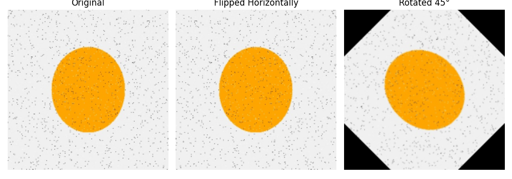
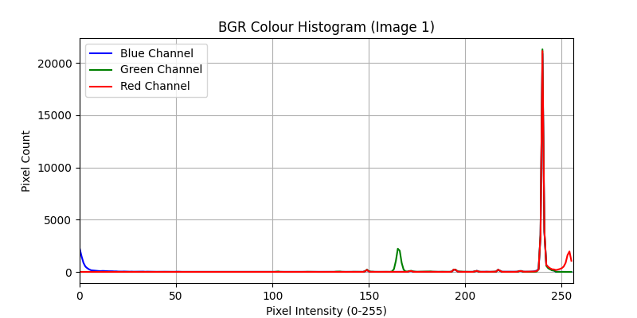
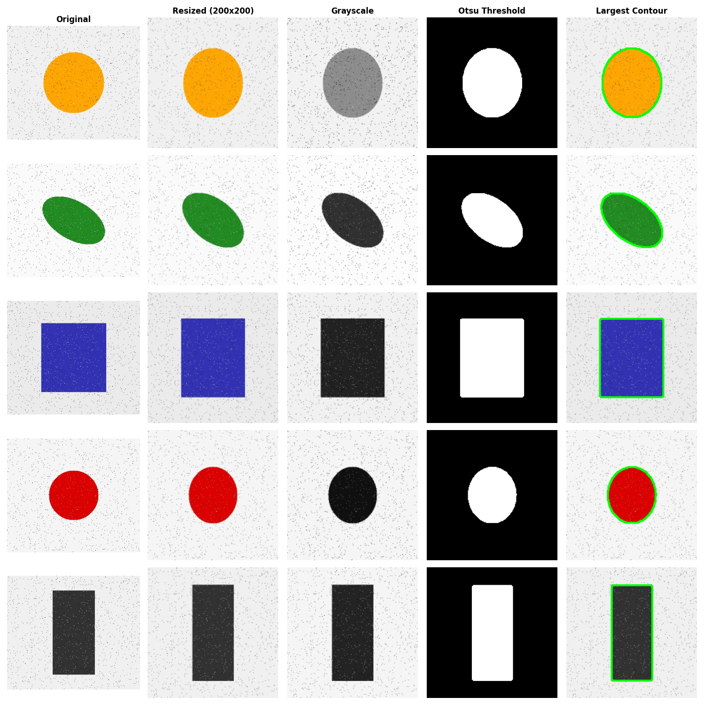

# 🧠 Deep Learning Final Project

### Five Practical Implementations of Deep Learning, Computer Vision & NLP

A collection of five practical deep learning tasks covering healthcare classification, image processing, computer vision, text sentiment analysis, and transformer-based Natural Language Processing (NLP).

This project demonstrates how different neural network architectures and pretrained transformer models can solve problems across structured data, images, and text.

---

## 🚀 Project Highlights

- 🏥 **Artificial Neural Network (ANN):** Breast cancer classification
- 🖼️ **OpenCV:** Image preprocessing, thresholding, contour detection, and augmentation
- 👕 **Convolutional Neural Network (CNN):** Fashion-MNIST image classification
- 🎬 **RNN/LSTM:** IMDB movie review sentiment classification
- 🤗 **Hugging Face Transformers:** Sentiment analysis, tokenization, and Named Entity Recognition (NER)

## 📊 Project Results

| Task | Model / Technique | Reported Result |
|---|---|---|
| Breast Cancer Classification | ANN | ~97.4% test accuracy |
| Image Processing | OpenCV | 5-image processing pipeline |
| Fashion Image Classification | CNN | ~88.5% test accuracy |
| Movie Review Classification | LSTM | ~83.2% test accuracy |
| Product Review Sentiment | Pretrained Transformer | 16/16 clearly polarized reviews classified correctly |

*Results are taken from the project's summary report. The sentiment result applies to the small evaluated review sample and should not be interpreted as a general benchmark.*

---

## 🖼️ Visual Results

### 1. Image Augmentation

The augmentation comparison demonstrates transformations applied to images, helping illustrate how image data can be modified for computer vision workflows.



### 2. Color Histogram Analysis

Color histograms help visualize the distribution of color intensities in an image and provide a basic understanding of its visual characteristics.



### 3. Image Processing Pipeline

The following grid summarizes image-processing outputs, including original and resized images, grayscale conversion, thresholding, and contour extraction.



---

## 🧩 Tasks Explained

### 1. 🏥 Breast Cancer Classification — ANN

**Objective:** Classify breast tumors as malignant or benign using numerical diagnostic features.

**Dataset:** Breast Cancer Wisconsin Diagnostic Dataset.

**Techniques used:**
- Data standardization and preprocessing
- Sequential Artificial Neural Network
- Dense layers and nonlinear activation functions
- Binary classification
- Model evaluation using accuracy and recall

**Reported result:** Approximately 97.4% test accuracy.

This task demonstrates how neural networks can learn patterns from structured medical data. The model is an educational demonstration and is not intended for clinical diagnosis.

### 2. 🖼️ Computer Vision — OpenCV

**Objective:** Build an image-processing pipeline to extract useful visual information from images.

**Techniques used:**
- Image resizing to 200 × 200
- Grayscale conversion
- Median filtering for noise reduction
- Otsu's thresholding
- Contour detection
- BGR color histogram analysis
- Geometric image augmentation, including rotation

**Outputs:** Processed images, color histograms, augmentation comparisons, and a combined 5 × 5 results grid.

This task demonstrates foundational computer vision techniques that are useful before applying more advanced deep learning models.

### 3. 👕 Fashion Image Classification — CNN

**Objective:** Classify grayscale clothing images into ten Fashion-MNIST categories.

**Dataset:** Fashion-MNIST.

**Architecture and techniques:**
- `Conv2D` layers for spatial feature extraction
- `MaxPooling2D` for dimensionality reduction
- `Dropout(0.3)` for regularization
- Multiclass classification
- Training and testing evaluation

**Reported result:** Approximately 88.5% test accuracy after eight epochs.

This experiment demonstrates why convolutional neural networks are effective for learning spatial patterns in image data.

### 4. 🎬 Movie Review Sentiment Analysis — LSTM

**Objective:** Predict whether an IMDB movie review expresses positive or negative sentiment.

**Dataset:** IMDB Movie Reviews.

**Architecture and techniques:**
- Text sequence preprocessing
- Embedding layer with 32 dimensions
- LSTM layer with 32 units
- Sequence padding with a maximum length of 100
- Binary sentiment classification

**Reported result:** Approximately 83.2% test accuracy after five epochs.

The LSTM architecture uses recurrent memory to learn contextual patterns in sequential text.

### 5. 🤗 Transformer-Based NLP

**Objective:** Explore pretrained transformer pipelines for product review analysis, tokenization, and entity recognition.

**Models and techniques:**
- `cardiffnlp/twitter-roberta-base-sentiment-latest` for sentiment analysis
- `distilbert-base-uncased` for subword tokenization analysis
- `dslim/bert-base-NER` for Named Entity Recognition
- Zero-shot-style sentiment inference on custom e-commerce reviews
- English and Hinglish review examples

**Evaluation:** The summary report records 16/16 correct predictions on the clearly polarized review subset.

This task demonstrates how pretrained language models can be used for NLP without training every model from scratch.

---

## 🛠️ Tech Stack

| Category | Technologies |
|---|---|
| Language | Python |
| Deep Learning | TensorFlow, Keras, PyTorch |
| Computer Vision | OpenCV |
| NLP | Hugging Face Transformers |
| Data Processing | NumPy, Pandas |
| Machine Learning Utilities | Scikit-learn |
| Visualization | Matplotlib, Seaborn |
| Development | Jupyter Notebook |

## 📁 Repository Structure

```text
DL_Final_Project/
│
├── main.ipynb
├── requirements.txt
├── summary_report.md
│
├── ann_cancer_model.h5
├── cnn_fashion_model.h5
├── rnn_imdb_model.h5
│
└── outputs/
    ├── augmentation_comparison.png
    ├── color_histogram.png
    ├── summary_5x5_grid.png
    ├── aug_rotated.jpg
    ├── img1_1_original.jpg
    ├── img1_2_resized.jpg
    ├── img1_3_gray.jpg
    ├── img1_4_thresh.jpg
    ├── img1_5_contour.jpg
    └── ...
```

The `main.ipynb` notebook contains the practical implementations, `outputs/` stores generated visual results, and the saved `.h5` files contain trained neural network models.

## ⚙️ Installation & Setup

### 1. Clone the repository

```bash
git clone https://github.com/Deepvejpara/DL_Final_Project.git
cd DL_Final_Project
```

### 2. Create a virtual environment

```bash
python -m venv venv
```

Activate it on Windows:

```bash
venv\Scripts\activate
```

Activate it on macOS or Linux:

```bash
source venv/bin/activate
```

### 3. Install dependencies

```bash
python -m pip install --upgrade pip
pip install -r requirements.txt
```

### 4. Launch the notebook

```bash
jupyter notebook main.ipynb
```

Run the notebook cells in order to explore the implementations and reproduce the experiments. Some transformer pipelines may download pretrained model weights on their first run, so an internet connection may be required.

## 📈 Key Learnings

Through these experiments, I explored:

- Choosing neural network architectures based on the data modality.
- Applying preprocessing and feature extraction to images.
- Understanding convolution, pooling, and dropout.
- Using embeddings and recurrent networks for sequential text.
- Applying pretrained transformers to sentiment analysis and entity extraction.
- Evaluating models using test accuracy and other classification metrics.
- Visualizing intermediate processing stages to better understand model inputs and outputs.

## 🔮 Future Improvements

- Add confusion matrices and detailed classification reports for every classifier.
- Compare CNN architectures and experiment with data augmentation.
- Explore bidirectional LSTMs and attention mechanisms for sentiment classification.
- Evaluate transformer models on larger, manually labeled datasets, including Hinglish reviews.
- Add reproducible training configurations and model evaluation notebooks.
- Improve model generalization through hyperparameter tuning and more systematic validation.

## 👨‍💻 Author

**Deep Vejpara**

- GitHub: [@Deepvejpara](https://github.com/Deepvejpara)
- Repository: [DL_Final_Project](https://github.com/Deepvejpara/DL_Final_Project)

---

⭐ If you find this project useful, consider giving the repository a star!

*Built as a hands-on learning project to explore Deep Learning, Computer Vision, and Natural Language Processing.*
